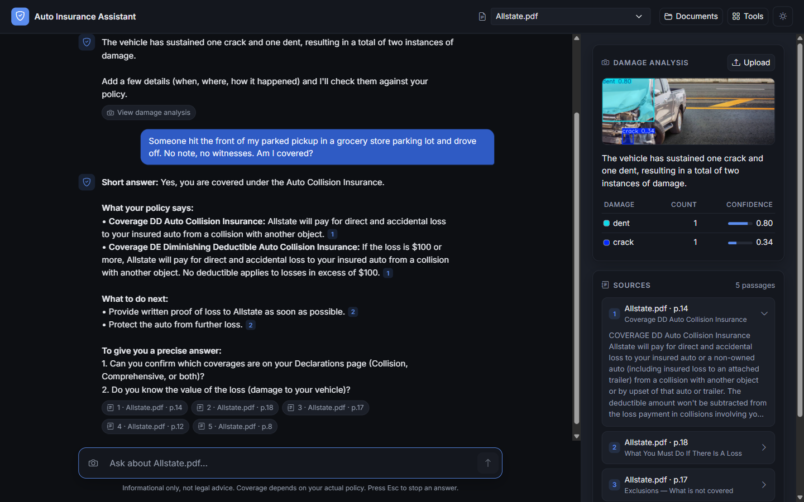
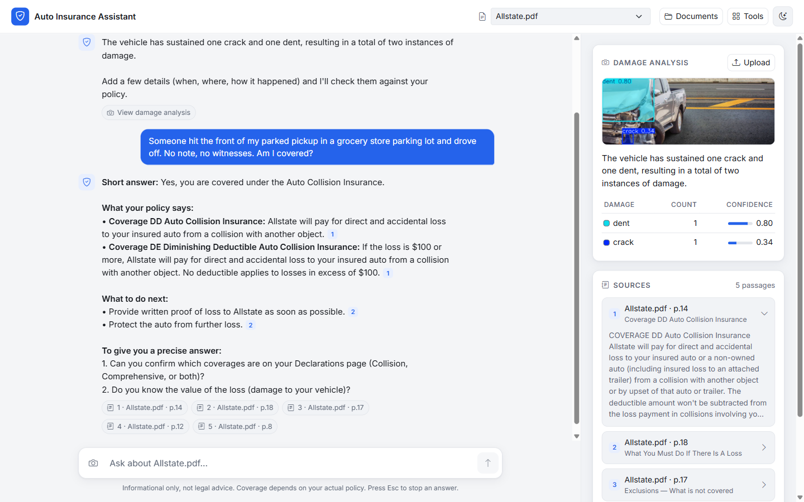
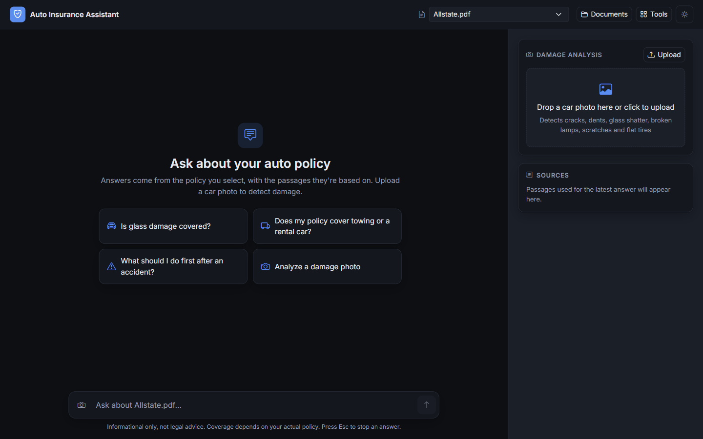
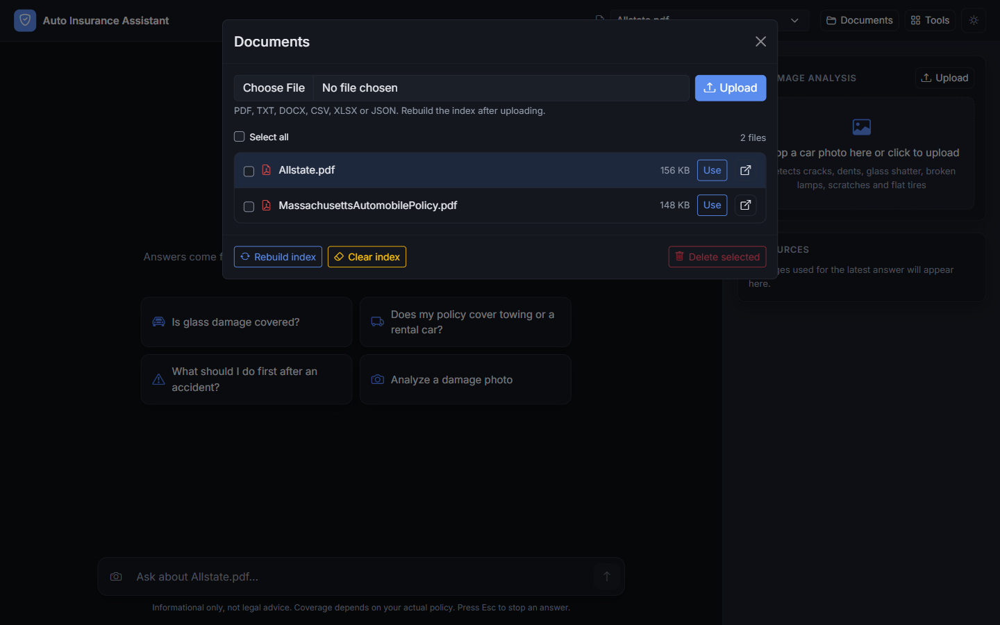
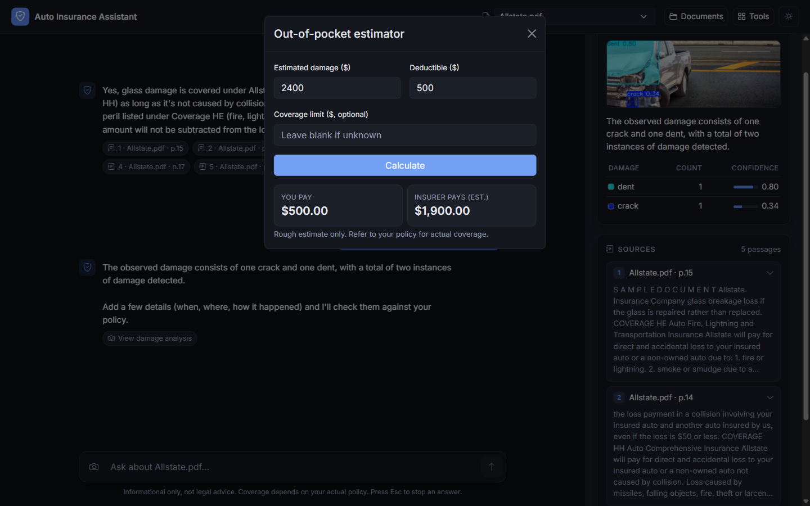

# Auto Insurance Assistant

An assistant for car-insurance claims. Describe what happened (and add a photo of the damage); it works out which coverage in **your own policy** applies, explains the conditions with **cited passages**, lists the steps the policy requires, and asks the follow-up questions that would change the answer.

It runs fully on your machine with a local model (Qwen 2.5 7B via Ollama), so no document or photo leaves the device, or with the **Google Gemini API**, which needs no GPU. It ships with an evaluation suite, MLflow tracking and tracing, a production Docker image and Kubernetes manifests.



## Features

- **Coverage-aware answers** – before searching, the assistant reads a catalogue of the policy's coverages (built automatically from its Parts and Coverage headings) and picks the ones whose definition fits the loss. "Someone hit my parked truck and drove off" goes to *Collision*, not to the *Uninsured Motorists* hit-and-run clause that merely sounds similar, and the coverage's *Exclusions* are pulled in automatically.
- **Cited sources** – every statement cites a numbered passage; each citation shows file, page range and policy section (e.g. *Coverage UU Rental Reimbursement*), and clicking it opens the passage in the side panel.
- **Follow-up questions** – when the answer depends on facts it doesn't have (which coverages you bought, whether anyone was hurt, whether the police were notified), it ends with 1–3 targeted questions, and it doesn't re-ask what you already said.
- **Conversation memory** – follow-ups such as "can I get a rental?" keep the context of the earlier turns.
- **Damage detection** – upload or drop a car photo; a YOLOv11-seg model trained on the [CarDD](https://cardd-ustc.github.io/) dataset segments six damage types (crack, dent, glass shatter, lamp broken, scratch, tire flat). The side panel shows the annotated image and a count/confidence table, and the findings are kept as known facts for the rest of the conversation.
- **Document management** – upload PDF / TXT / DOCX / CSV / XLSX / JSON files, rebuild or clear the index, delete files.
- **Quick tools** – out-of-pocket estimator, FAQs, contact form. Claim status is a demo stub.
- **Light and dark themes**, phone-width layout.
- **Measured and observable** – a scenario test set with traps (`manage.py evaluate`), every evaluation logged as an MLflow run, and every chat turn traced step by step.
- **Deployable** – production settings, a read-only public demo mode, a Docker image and Kubernetes manifests with health and readiness probes.

<details>
<summary>More screenshots</summary>

| | |
|---|---|
|  |  |
| Light theme | Start screen with suggested questions |
|  |  |
| Document manager | Out-of-pocket estimator |

</details>

## How it works

```
Indexing   policy PDF → clean text (watermarks removed) → 800-char chunks that run across page breaks
                      → each chunk tagged with its section ("Part 6 … / Coverage DD Auto Collision Insurance")
                      → all-MiniLM-L6-v2 embeddings → FAISS
                      → coverage catalogue: every Part / Coverage / Exclusions / duties section + its opening words

Question   1. route     LLM reads the catalogue + the customer's situation → picks the coverage(s) that fit
                        (+ that Part's Exclusions)
           2. retrieve  routed sections, starting at their heading, + top vector-search hits from the same policy
                        (each hit extended with the next chunk of its section)
           3. answer    system prompt + last turns + photo facts + numbered passages → LLM (Gemini API or Ollama)
                        → streamed answer: short answer · what your policy says [n] · what to do next · questions
                        citations (file, page range, section) go to the UI in the X-Sources header

Photo      YOLOv11-seg (CarDD, 6 classes) → masks + counts → LLM summary → kept as facts for the conversation
```

| Layer | Tech |
|---|---|
| Web app | Django 5.1, Bootstrap 5 + Bootstrap Icons, vanilla JS (streaming via `fetch` + `ReadableStream`) |
| Retrieval | LangChain loaders, section-aware chunking, `sentence-transformers` (all-MiniLM-L6-v2), FAISS, LLM coverage routing |
| Generation | Qwen 2.5 7B through [Ollama](https://ollama.com), or the Google Gemini API (OpenAI-compatible endpoint, via the `openai` SDK); a Hugging Face backend is also supported |
| Vision | Ultralytics YOLOv11 segmentation, OpenCV |
| Evaluation and observability | Scenario test set + scorer, MLflow 3 (runs and traces, local SQLite) |
| Deployment | Gunicorn + WhiteNoise, Docker (CPU-only image), Kubernetes with Kustomize |

### Project layout

```
.
├── Dockerfile, .dockerignore   # production image (CPU, Gemini API, read-only demo by default)
├── docker-compose.yml          # run that image locally
├── k8s/
│   ├── base/                   # namespace, ConfigMap, Deployment (probes, limits, non-root), Service
│   └── overlays/local/         # Docker Desktop: local image, localhost:8080, Secret from secrets.env
├── requirements.txt
├── .env.example                # Gemini key, Django secret, MLflow options -> copy to .env
└── insuranceasst/              # Django project (run manage.py from here)
    ├── backend/
    │   ├── data_loader.py      # load PDF/TXT/CSV/XLSX/DOCX/JSON, strip page watermarks
    │   ├── embedding.py        # section detection + cross-page chunking + embeddings
    │   ├── vectorstore.py      # FAISS index: build, save/load, per-file query (optional BM25 hybrid)
    │   ├── search__.py         # RAGSearch: coverage catalogue + routing, retrieval, prompt, Gemini/Ollama/HF backends
    │   └── tracing.py          # MLflow tracing helpers (no-op when MLflow is off or missing)
    ├── chat/
    │   ├── views.py            # page + JSON/streaming API, /health/, /ready/, demo-mode guard
    │   ├── templates/chat/index.html
    │   ├── static/chat/        # script.js, style.css
    │   └── management/commands/
    │       ├── build_index.py  # python manage.py build_index
    │       └── evaluate.py     # python manage.py evaluate (see "Checking answer quality")
    ├── eval/scenarios.json     # test conversations with the correct coverage, pages and traps
    ├── insuranceasst/          # settings.py (environment-driven), urls.py, wsgi.py
    ├── gunicorn.conf.py        # production server settings
    ├── data/                   # policy documents (served at /media/); claim photos in data/images/claims/
    ├── faiss_store/            # generated vector index
    └── models/                 # YOLO weights (yolov11-seg-cardd.pt)
```

## Getting started

### Prerequisites

- Python 3.11
- A language model, either:
  - **local:** [Ollama](https://ollama.com/download) with `ollama pull qwen2.5:7b` (~4.7 GB; an NVIDIA GPU with ~6 GB free VRAM is recommended), or
  - **no GPU:** a Google Gemini API key. See [Choosing the language model](#choosing-the-language-model).
- Everything else runs on CPU: the embedding model is small, and YOLO falls back to CPU automatically (about a second per photo). Install the CUDA build of PyTorch only if you want GPU vision inference.
- Optional: Docker Desktop, for the container and Kubernetes setup in [Deployment](#deployment-docker-and-kubernetes).

### Install

```bash
git clone <this-repo>
cd InsurnceAsst
python -m venv .venv
# Windows (Git Bash): source .venv/Scripts/activate   PowerShell: .venv\Scripts\Activate.ps1   macOS/Linux: source .venv/bin/activate
pip install -r requirements.txt
```

### Add the assets that are not in git

PDFs, model weights and the index are git-ignored, so add them before the first run:

1. **Policy documents** – put one or more policy files in `insuranceasst/data/` (or upload them later from the UI).
2. **Vision model** – place the trained CarDD YOLOv11-seg weights at `insuranceasst/models/yolov11-seg-cardd.pt` (path set by `CARDD_MODEL_PATH` in settings).

### Run

```bash
cd insuranceasst
python manage.py migrate            # first run only
python manage.py build_index        # rebuild after changing documents (also built automatically on first use)
python manage.py runserver
```

Open <http://127.0.0.1:8000>, pick a policy in the top bar, then ask a question or upload a car photo in the **Damage analysis** panel.

Run these with the venv active. `runserver` is for local development: `DEBUG` is on and every feature, including upload and delete, is available. For the production setup, see [Deployment](#deployment-docker-and-kubernetes).

The first question after startup waits while the embedding model and YOLO load (about 30 seconds on CPU). After that, answers start within a few seconds with Gemini; a local 7B model on a GPU takes longer for the first answer, which loads the model.

## Choosing the language model

The model is chosen with environment variables, read from a git-ignored `.env` file in the repo root.

**Google Gemini API (no GPU needed):**

1. Create an API key in [Google AI Studio](https://aistudio.google.com).
2. Copy the template and put your key in it:
   ```bash
   cp .env.example .env
   ```
   ```
   LLM_BACKEND=openai
   LLM_API_KEY=<your Gemini key>
   LLM_MODEL=gemini-3.5-flash-lite
   ```
3. Restart Django.

The app talks to Gemini through its OpenAI-compatible endpoint (`https://generativelanguage.googleapis.com/v1beta/openai/`, the default for `LLM_BACKEND=openai`). To see which models your key can use:

```bash
curl -s "https://generativelanguage.googleapis.com/v1beta/openai/models" -H "Authorization: Bearer <your key>"
```

Use the model name without the `models/` prefix. Prefer non-"thinking" flash/lite models: the coverage-routing step allows only a short reply, and models that reason before answering can return nothing within it.

**Local alternative:** leave `.env` out (or set `LLM_BACKEND=ollama`) to use Ollama with `qwen2.5:7b`.

Things to know:
- **Privacy:** with Gemini, questions and policy passages are sent to Google, and free-tier prompts may be used to improve Google's products. Use it with the sample policies, not real customer documents; use Ollama for those.
- **Limits:** free-tier rate and daily limits apply, and models are retired over time (e.g. `gemini-2.5-flash` is no longer offered to new users), so check the model list if a model stops working.
- If the API can't be reached, the chat shows *"the language model is unavailable … check that &lt;URL&gt; is running"*, and routing falls back to plain search.

## Configuration

Set in `insuranceasst/insuranceasst/settings.py`. The `LLM_*` values come from environment variables or `.env`:

| Setting | Default | Purpose |
|---|---|---|
| `LLM_BACKEND` | `"ollama"` | `"openai"` (Gemini API), `"ollama"` or `"hf"` (Hugging Face Transformers, 4-bit) |
| `LLM_MODEL` | `"qwen2.5:7b"` (`"gemini-3.5-flash-lite"` for `openai`) | Gemini model name, Ollama model name, or a Hugging Face repo id |
| `LLM_BASE_URL` | Gemini's OpenAI-compatible endpoint for `openai` | Override only to use another OpenAI-compatible API |
| `LLM_API_KEY` | – | Gemini API key. Keep it in `.env`, never in git |
| `RAG_ROUTE` | `True` | LLM picks the relevant coverage sections from the policy's catalogue before searching |
| `RAG_NEIGHBORS` | `True` | Extend each retrieved chunk with the next chunk of the same section |
| `RAG_HYBRID` | `False` | Fuse BM25 keyword search with vector search (needs `rank_bm25`) |
| `RAG_EXPAND_QUERY` | `False` | LLM rewrites the customer's story into policy terms before searching |
| `FAISS_DIR` | `BASE_DIR / "faiss_store"` | Where the vector index is stored |
| `MEDIA_ROOT` | `BASE_DIR / "data"` | Document and claim-photo folder |
| `CARDD_MODEL_PATH` | `models/yolov11-seg-cardd.pt` | YOLO segmentation weights |

The `OLLAMA_HOST` environment variable points the app at a non-default Ollama server. Rebuild the index (`build_index` or **Documents → Rebuild index**) after changing documents or upgrading, so chunks carry section and page-range data.

Deployment and observability settings, all environment variables. None are needed for local `runserver`:

| Variable | Default | Purpose |
|---|---|---|
| `DJANGO_DEBUG` | `1` | `0` in production (the Docker image sets it) |
| `DJANGO_SECRET_KEY` | dev-only key | **Required** when `DJANGO_DEBUG=0`; the app refuses to start without it |
| `DJANGO_ALLOWED_HOSTS` | – | Comma-separated hostnames, e.g. `localhost,insurance.example.com` |
| `DJANGO_CSRF_TRUSTED_ORIGINS` | – | e.g. `https://insurance.example.com` |
| `DJANGO_BEHIND_TLS_PROXY` | `0` | `1` behind an HTTPS ingress: secure cookies, HTTPS redirect, HSTS (`DJANGO_HSTS_SECONDS`) |
| `DEMO_READONLY` | `0` (`1` in the image) | Turns off upload, delete, rebuild index and clear index (API returns 403; UI hides them) |
| `DJANGO_STATIC_ROOT` | `insuranceasst/staticfiles` | Where `collectstatic` writes |
| `GUNICORN_THREADS` / `GUNICORN_TIMEOUT` | `8` / `300` | Production server tuning (`gunicorn.conf.py`) |
| `MLFLOW_TRACING` | `1` (`0` in the image) | Per-request tracing on or off |
| `MLFLOW_TRACKING_URI` | `sqlite:///mlflow.db` (repo root) | Where runs and traces go |

## API

| Method | Endpoint | Body | Returns |
|---|---|---|---|
| `POST` | `/api/chat/stream/` | `{"message", "doc"?, "history"?, "facts"?}` | Streamed plain-text answer; citations in the `X-Sources` header |
| `GET`/`POST` | `/api/chat/` | `?q=&doc=` or `{"message", "doc"?, "history"?}` | `{"answer"}` |
| `POST` | `/api/vision/analyze/` | multipart `image` | `{"annotated_url", "counts", "detections", "summary"}` |
| `GET` | `/api/files/` | – | Files in `data/` |
| `POST` | `/api/files/upload/` | multipart `file` | `{"saved_as", "url"}` |
| `POST` | `/api/files/delete/` | `{"names": [...]}` | `{"deleted", "missing"}` |
| `POST` | `/api/reindex/` | – | Rebuilds the FAISS index from `data/` |
| `POST` | `/api/vectors/clear/` | – | Deletes the FAISS index |
| `GET` | `/health/` | – | `{"ok": true}` (liveness) |
| `GET` | `/ready/` | – | `{"ready": true}` once models are loaded, `503` before (readiness) |

- With `DEMO_READONLY=1`, upload, delete, reindex and clear return `403` with `{"ok": false, "error": "This demo is read-only…"}`.
- `doc` is a file name such as `Allstate.pdf`; retrieval is limited to that file.
- `history` is the last few turns as `[{"role": "user"|"assistant", "content": "..."}]` (the server keeps the last 6).
- `facts` is free text the assistant should treat as known, e.g. the photo-analysis findings.
- `X-Sources` is a JSON array of `{"name", "page", "page_end", "section", "snippet"}` (1-based pages; `null` for non-PDF files). It is a header so the answer can start streaming immediately.

## Checking answer quality

`eval/scenarios.json` holds realistic claim conversations for both sample policies (hit-and-run, deer strike, cracked windshield, theft, rental, breakdown and tow, injury by an uninsured driver, an out-of-scope premium question, and Massachusetts-specific rules). Each turn records the correct answer, the pages it comes from, phrases the answer must contain, statements it must not make (traps such as "Uninsured Motorists pays for the car"), and what good follow-up questions look like.

```bash
cd insuranceasst
python manage.py evaluate                              # current settings and model
python manage.py evaluate --model mistral --route off  # compare a model / switch features
python manage.py evaluate --regrade <run-folder>       # re-score saved answers after editing the scenarios
```

Each run writes `results.md` (per-turn answers, sources and problems) and `results.json` to `eval-runs/<date>_<label>/`, which is git-ignored. Use it to compare models and retrieval settings on your own hardware before changing defaults.

## Experiment tracking and tracing (MLflow)

[MLflow](https://mlflow.org) records two things, both stored locally in `mlflow.db` + `mlruns/` (git-ignored):

| | What | Where in the UI |
|---|---|---|
| **Runs** | every `manage.py evaluate`: parameters (model, backend, routing, top-k, chunk size, …), metrics (`pass_rate`, `retrieval_hit_rate`, `citation_ok_rate`, `avg_seconds`, and a `pass.<scenario>.t<turn>` 0/1 per test turn), a per-turn table and `results.md` | Experiment **insurance-assistant-eval** → compare runs side by side |
| **Traces** | every chat turn: `chat_turn` → `prepare` → `route_sections` (the LLM's section choice) → `retrieve` (passages found) → the LLM call (exact prompt and answer), with timings. Photo uploads trace `vision_analyze` → `yolo.predict` → the summary call | Experiment **insurance-assistant-chat** → *Traces* tab; eval turns appear under the eval run |

```bash
# from the repo root, with the venv active
mlflow ui --backend-store-uri sqlite:///mlflow.db --port 5000
# if the mlflow launcher won't run (e.g. "Permission denied" in Git Bash): python -m mlflow ui ...same options
# open http://127.0.0.1:5000
```

- Traces include questions, policy passages and answers. They stay on your machine, but don't share `mlflow.db`.
- Turn tracing off with `MLFLOW_TRACING=0`, skip run logging with `evaluate --no-mlflow`, or point everything at an MLflow server with `MLFLOW_TRACKING_URI`.
- The app runs without MLflow installed; tracing then becomes a no-op.

## Deployment (Docker and Kubernetes)

The production image runs Gunicorn with `DEBUG` off, serves static files with WhiteNoise, and defaults to a **read-only public demo** (`DEMO_READONLY=1`): chat and photo analysis work, but uploading, deleting and re-indexing are disabled in both the API (HTTP 403) and the UI. The language model is the Gemini API, so no GPU is needed. The YOLO weights, the sample policies, the embedding model and the search index are baked into the image at build time.

| Endpoint | Purpose |
|---|---|
| `/health/` | Liveness: the process is up |
| `/ready/` | Readiness: `503` until the models are loaded (loading starts on the first call), then `200` |

### Docker

```bash
# repo-root .env needs LLM_API_KEY (Gemini) and DJANGO_SECRET_KEY, see .env.example
docker compose up --build        # http://localhost:8000
```

### Kubernetes (Docker Desktop)

1. Docker Desktop → **Settings → Kubernetes → Enable Kubernetes**, then `kubectl config use-context docker-desktop`.
2. Build the image (the cluster uses it straight from Docker; no registry): `docker build -t insurance-assistant:latest .`
3. Create the secret file: `cp k8s/overlays/local/secrets.env.example k8s/overlays/local/secrets.env` and fill in `DJANGO_SECRET_KEY` and `LLM_API_KEY` (git-ignored).
4. Deploy and watch it become ready (the pod loads the models first, about 30 seconds):
   ```bash
   kubectl apply -k k8s/overlays/local
   kubectl -n insurance-assistant rollout status deployment/insurance-assistant
   ```
5. Open <http://localhost:8080>.

Useful commands:

```bash
kubectl -n insurance-assistant get pods                          # status, restarts
kubectl -n insurance-assistant logs deploy/insurance-assistant -f # Gunicorn + app logs
# after code changes: rebuild the image, then replace the pod
docker build -t insurance-assistant:latest . && kubectl -n insurance-assistant rollout restart deployment/insurance-assistant
kubectl delete -k k8s/overlays/local                             # remove everything
```

On Windows Git Bash, prefix `docker run` commands that use container paths (e.g. `--tmpfs /tmp`) with `MSYS_NO_PATHCONV=1`; otherwise Git Bash rewrites them into Windows paths.

How the manifests are organised (Kustomize, built into `kubectl`): `k8s/base` holds what every environment shares (namespace, ConfigMap with non-secret settings, Deployment, Service). `k8s/overlays/local` adds the Secret (from the git-ignored `secrets.env`), uses the local image (`imagePullPolicy: Never`) and exposes it on `localhost:8080`. The Deployment runs as a non-root user with a read-only root filesystem; only `/tmp` and the claim-photo folder are writable (`emptyDir`, so photos disappear on restart). Its probes send `Host: localhost` because the kubelet calls the pod by IP, which `ALLOWED_HOSTS` would reject. It runs a single replica because claim photos live inside the pod.

## Limitations

- **Not legal or insurance advice.** Answers come from small models (a local 7B model or Gemini Flash-Lite). They can pick the wrong coverage (for example suggesting Limited Collision for a hit-and-run, which that coverage excludes), miss an exception that is in a cited passage, overstate certainty ("you are covered" rather than "you are covered if you bought collision"), or answer questions the policy doesn't address. Check the cited passages before relying on an answer.
- **Follow-up questions are uneven** – often useful ("Which coverages are on your Declarations page?"), sometimes off-target.
- **Coverage routing relies on section headings.** It is built for policies organised in Parts and Coverages with a table of contents (as in the two sample policies); other documents fall back to plain vector search.
- **No user accounts.** Write endpoints have no login or CSRF protection, so anything reachable from a network should run with `DEMO_READONLY=1` (the image's default).
- **Single replica.** Uploaded and annotated photos live inside the pod (`emptyDir`): they vanish on restart, a restart briefly takes the site down, and a second replica couldn't serve the first one's photos. Scaling out needs shared storage.
- **Large image** (about 4.6 GB, mostly PyTorch and document-loader dependencies the demo doesn't use).
- The vision model detects damage *types*, not severity or repair cost, and only the six CarDD classes.
- Claim status is a placeholder response.
